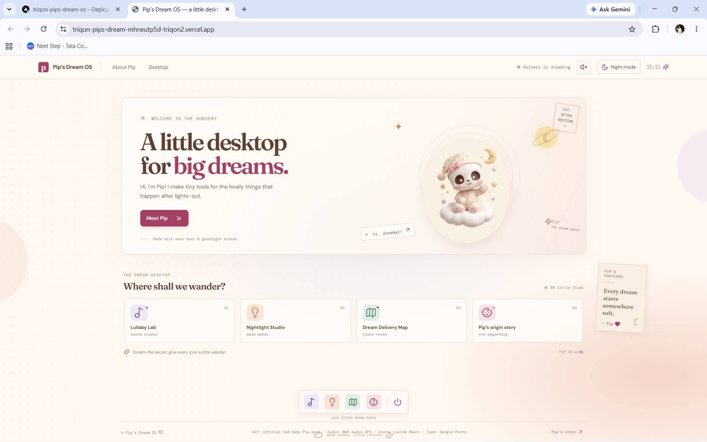
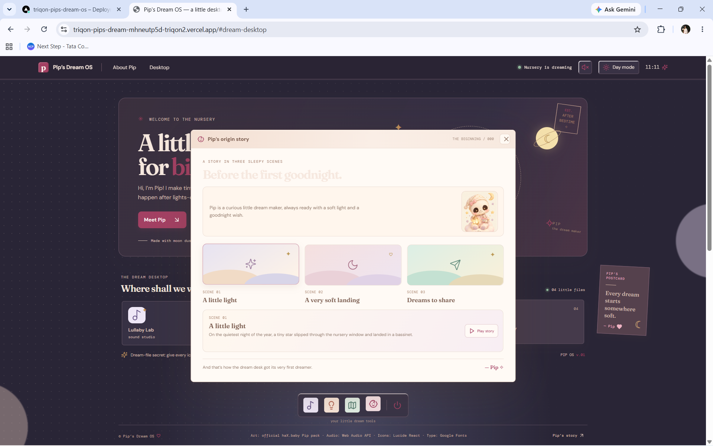
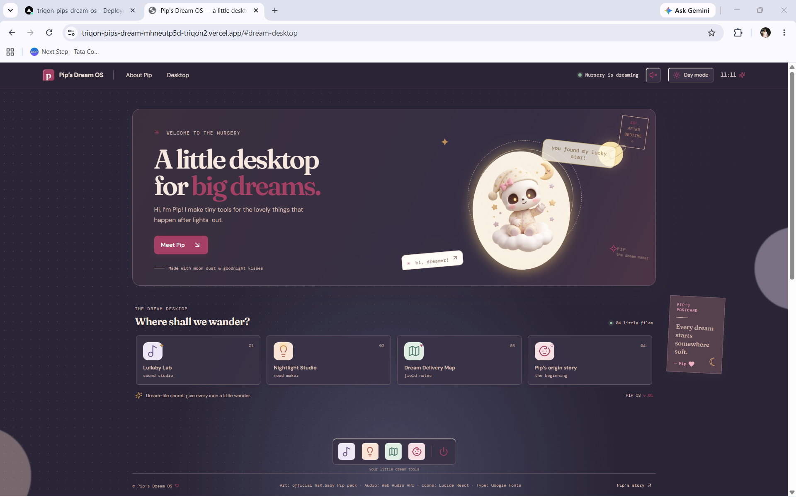

# Pip’s Dream OS

Pip’s Dream OS is a character-focused, retro-inspired interactive portfolio for Pip, the Junior Dream Engineer. Explore Pip’s nursery desktop and discover projects and stories from a playful dream world.

## Live Demo

[https://triqon-pips-dream-os.vercel.app/](https://triqon-pips-dream-os.vercel.app/)

## Features

- An interactive dream desktop with four draggable project files, including Pip’s Lullaby Lab, Nightlight Studio, and Dream Delivery Map.
- A hidden dream file revealed by moving all four desktop files.
- A three-scene interactive origin story.
- Dream Delivery Map: choose a destination by tapping a map landmark or using the destination selector, then send Pip along an animated route.
- Day/night mode and sound controls.
- Responsive layout for mobile screens.

## Tech Stack

- React
- Vite
- JavaScript
- CSS
- Web Audio API
- Lucide React
- Google Fonts

## Getting Started

Install the dependencies and start the development server:

```bash
npm install
npm run dev
```

## Quality Checks

```bash
npm run lint
npm run build
```

## Team

Triqon

## Credits

- Official haX.baby Pip asset pack
- Lucide React
- Google Fonts
- Web Audio API
- AI coding assistance

## Story Behind the Build

Pip’s character and dream world inspired us to make more than a conventional portfolio. We turned them into an interactive desktop so visitors can explore Pip’s projects and story in a playful, character-led way.

## Screenshots

### Homepage



### Dream Desktop



### Easter Egg


